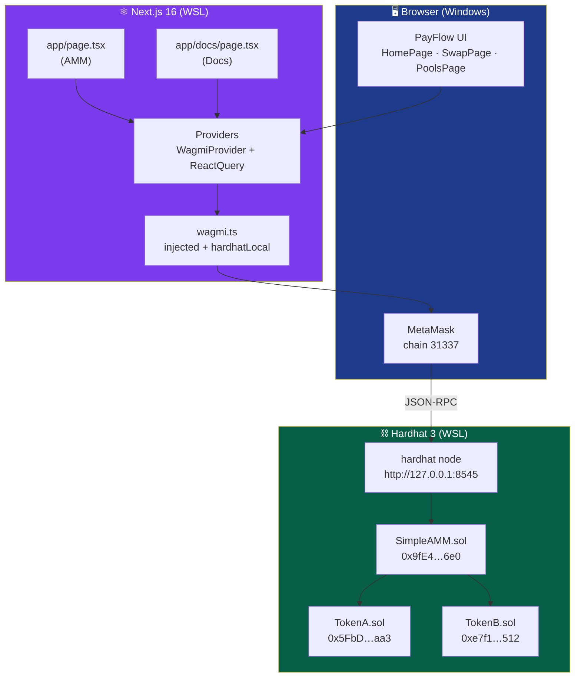
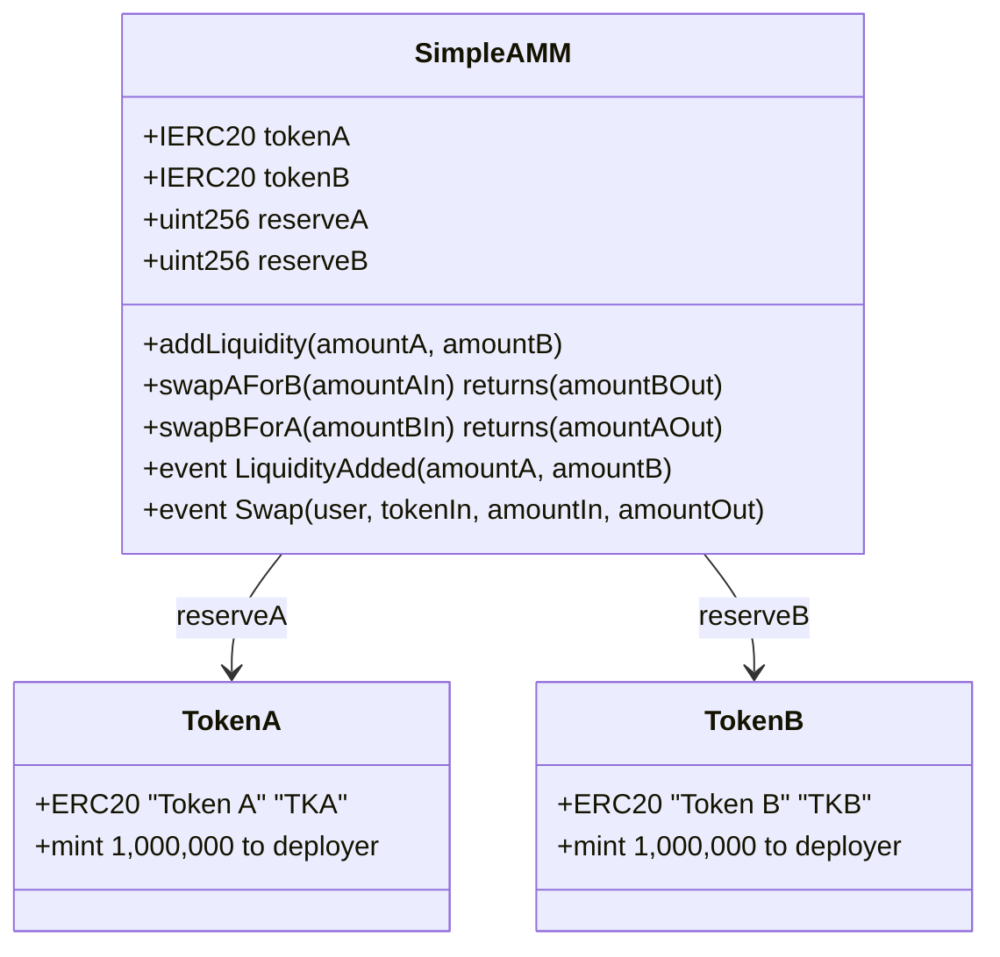
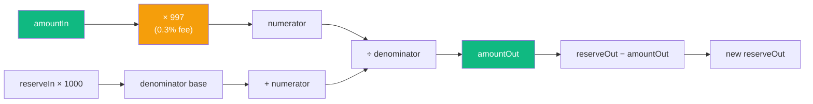
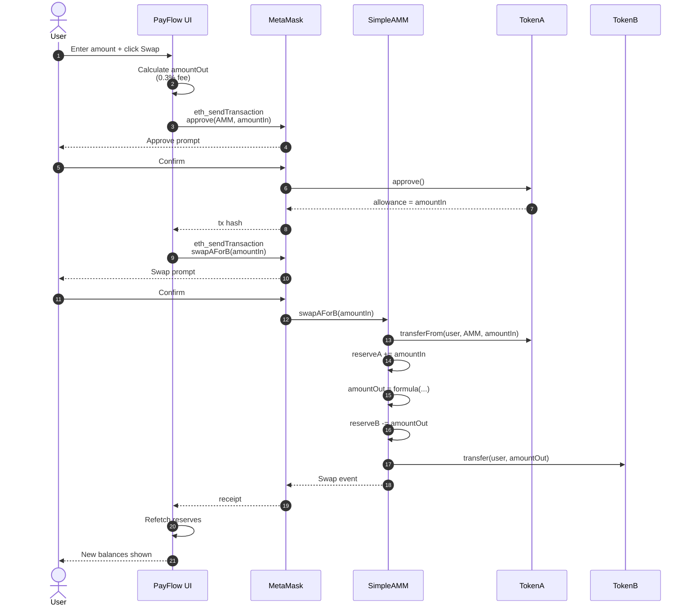
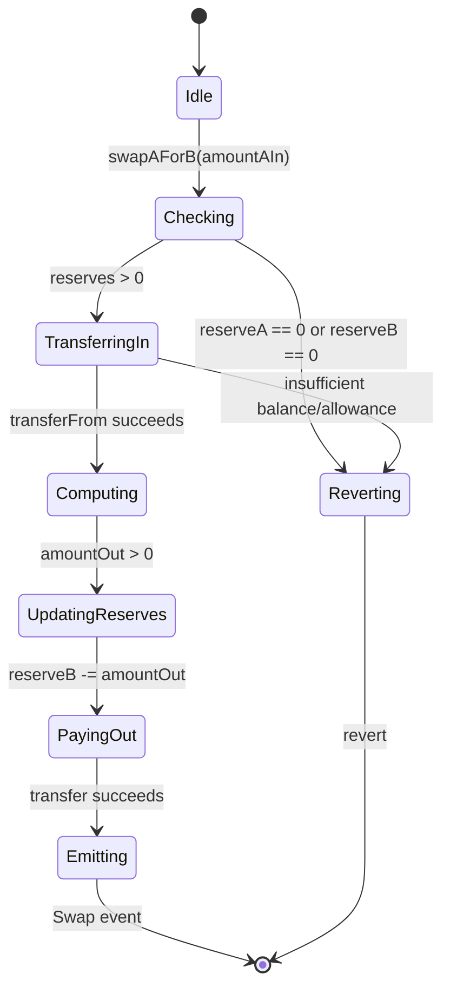
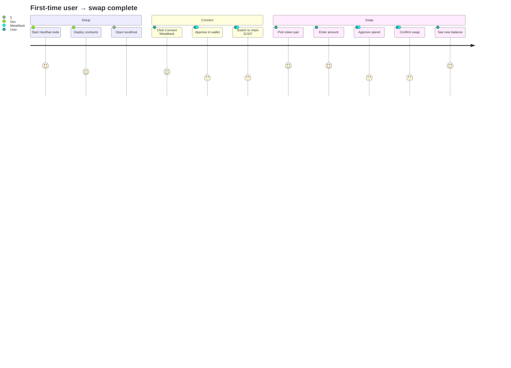
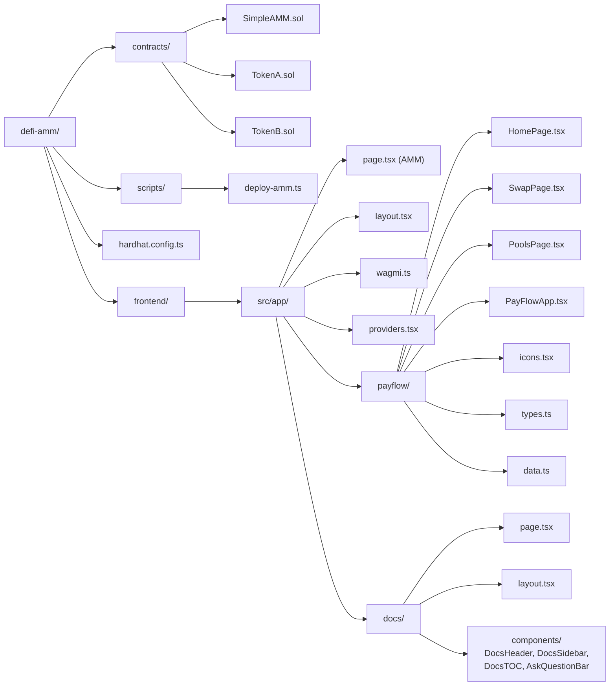
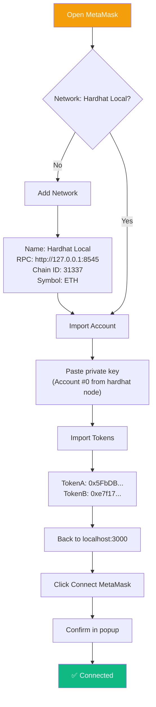
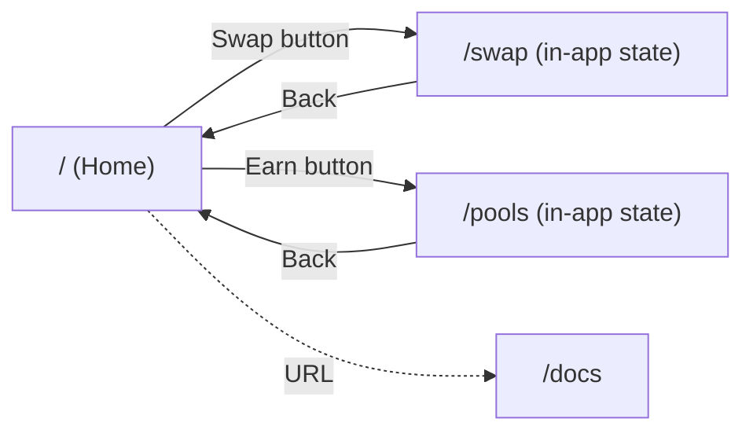

# PayFlow — DeFi AMM


A full-stack **hybrid wallet + DeFi AMM** demo running on a local Hardhat chain. Single-pool constant-product AMM with 0.3% swap fee, a PayFlow-style mobile UI, and an in-app docs page.

---

## 📑 Table of Contents

- [Features](#-features)
- [Architecture](#-architecture)
- [Contract Design](#-contract-design)
- [Swap Flow](#-swap-flow)
- [User Journey](#-user-journey)
- [Tech Stack](#-tech-stack)
- [Directory Structure](#-directory-structure)
- [Quick Start](#-quick-start)
- [MetaMask Setup](#-metamask-setup)
- [Environment Variables](#-environment-variables)
- [Routes](#-routes)
- [Troubleshooting](#-troubleshooting)
- [License](#-license)

---

## ✨ Features

- **Constant-product AMM** (`x * y = k`) with 0.3% fee
- **Single-pool** TKA ↔ TKB swap
- **Two-token liquidity** with reserve tracking on-chain
- **Injected wallet** connection (MetaMask, no WalletConnect required for local dev)
- **SSR-safe** Web3 state (cookie-based hydration, no flicker)
- **PayFlow UI** — mobile-first wallet dashboard (balance, quick actions, swap, earn)
- **Docs site** at `/docs` with auto-generated table of contents
- **Dark theme** across the whole app

---

## 🏗️ Architecture



---

## 📜 Contract Design

### SimpleAMM

Single-pool AMM storing two reserves. No factory, no router — the pair **is** the entry point.



### Fee Formula



**Formula**: `amountOut = (amountIn × 997 × reserveOut) / (reserveIn × 1000 + amountIn × 997)`

---

## 🔄 Swap Flow

### Sequence: User swaps TKA → TKB



### State Machine: Contract-level swap



---

## 🚀 User Journey



---

## 🧰 Tech Stack

| Layer | Technology | Purpose |
|---|---|---|
| **Contracts** | Solidity 0.8.24 | AMM + ERC20 tokens |
| **Dev chain** | Hardhat 3 (EDR) | Local JSON-RPC at `:8545` |
| **Testing** | Mocha + Ethers.js (via Hardhat) | Contract test suite |
| **Frontend** | Next.js 16 (App Router, Turbopack) | SSR + client routing |
| **UI runtime** | React 19 | Server + client components |
| **Language** | TypeScript 7 | Full type safety |
| **Styling** | Tailwind 4 (CSS-first `@theme`) | Utility CSS + tokens |
| **Components** | shadcn/ui + ai-elements | Accessible primitives |
| **Web3** | wagmi v2 + viem | Hooks + typed contract calls |
| **Wallet** | Injected (MetaMask) | No WalletConnect needed |
| **State** | TanStack Query v5 | Cache + refetch |

---

## 📁 Directory Structure



---

## ⚡ Quick Start

### Prerequisites

- Node.js ≥ 22 LTS
- WSL2 (Ubuntu) or native Linux/macOS
- MetaMask browser extension

### 1. Backend

```bash
# Terminal 1 — local chain
npx hardhat node

# Terminal 2 — deploy + seed liquidity
npx hardhat run scripts/deploy-amm.ts --network localhost
```

Copy the three printed addresses into `frontend/.env.local`.

### 2. Frontend

```bash
cd frontend
cp .env.example .env.local        # then fill in the addresses
npm install --legacy-peer-deps
npm run dev
```

Open:
- **AMM**: <http://localhost:3000/>
- **Docs**: <http://localhost:3000/docs>

---

## 🦊 MetaMask Setup



| Field | Value |
|---|---|
| Network Name | Hardhat Local |
| RPC URL | `http://127.0.0.1:8545` |
| Chain ID | `31337` |
| Currency | ETH |

**Test account** (from `hardhat node` output):

```
Address:     0xf39fd6e51aad88f6f4ce6ab8827279cfffb92266
Private key: 0xac0974bec39a17e36ba4a6b4d238ff944bacb478cbed5efcae784d7bf4f2ff80
```

> ⚠️ **Never use these on a real chain** — they are publicly known.

---

## 🔐 Environment Variables

`frontend/.env.local`:

| Variable | Description | Example |
|---|---|---|
| `NEXT_PUBLIC_WC_PROJECT_ID` | WalletConnect / Reown Project ID (optional for injected-only) | `abc123…` |
| `NEXT_PUBLIC_AMM_ADDRESS` | Deployed `SimpleAMM` address | `0x9fE4…` |
| `NEXT_PUBLIC_TOKEN_A_ADDRESS` | Deployed `TokenA` address | `0x5FbD…` |
| `NEXT_PUBLIC_TOKEN_B_ADDRESS` | Deployed `TokenB` address | `0xe7f1…` |

> `.env.local` is git-ignored. Use `.env.example` as the template.

---

## 🛣️ Routes

| Route | Description |
|---|---|
| `/` | PayFlow AMM — dashboard, swap, earn |
| `/docs` | Documentation with sidebar + TOC + ask bar |

### In-app navigation



The PayFlow app uses **internal state** for `home` / `swap` / `pools` navigation (no URL change), keeping the wallet connection alive across views.

---

## 🩺 Troubleshooting

<details>
<summary><b>ERESOLVE peer dependency error on <code>npm install</code></b></summary>

Add to `frontend/package.json`:

```json
"overrides": {
  "@solana/kit": { "typescript": "$typescript" }
}
```

Then `rm -rf node_modules package-lock.json && npm install`.
</details>

<details>
<summary><b><code>403 Forbidden</code> from Reown</b></summary>

You're using the placeholder `projectId`. Either:
- Get a real one at [dashboard.reown.com](https://dashboard.reown.com), or
- We already removed RainbowKit's `getDefaultConfig` — the app uses injected wallets only, so this warning is harmless.
</details>

<details>
<summary><b>Tailwind classes not applying (<code>bg-brand-*</code> shows nothing)</b></summary>

All tokens live in `frontend/src/app/globals.css` under `@theme`. If you deleted them, re-add:

```css
@theme inline {
  --color-brand-blue: #0070BA;
  /* ... */
}
```
</details>

<details>
<summary><b>MetaMask shows 0 balance</b></summary>

- Chain must be `31337`
- Import the **deployer** account (`0xf39f…`)
- Tokens don't appear automatically — import `TokenA` / `TokenB` addresses manually
</details>

<details>
<summary><b>Swap reverts with <code>execution reverted</code></b></summary>

- Confirm the `approve` tx mined before clicking Swap
- Ensure `balanceOf(user) ≥ amountIn`
- Check `reserveA > 0 && reserveB > 0` (add liquidity if empty)
</details>

---

## 🧪 Contract Tests

```bash
npx hardhat test
```

Covers:
- Add liquidity math
- Swap fee calculation (0.3%)
- Reserve updates post-swap
- Revert on zero-liquidity swaps

---

## 📜 License

MIT © 2026 kk666679
