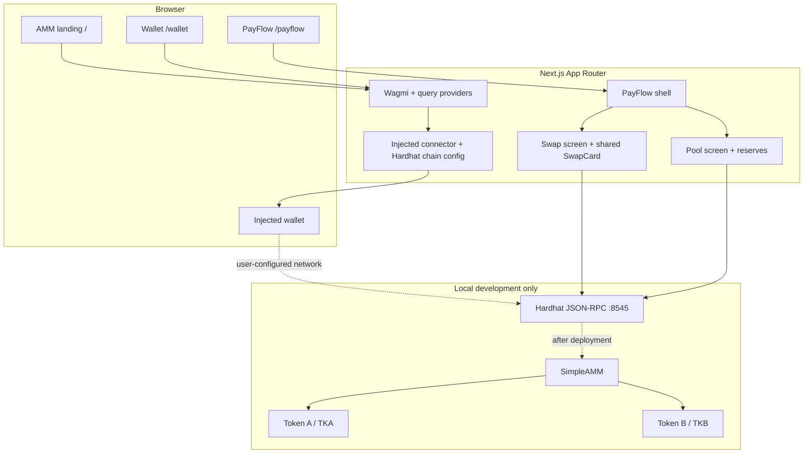
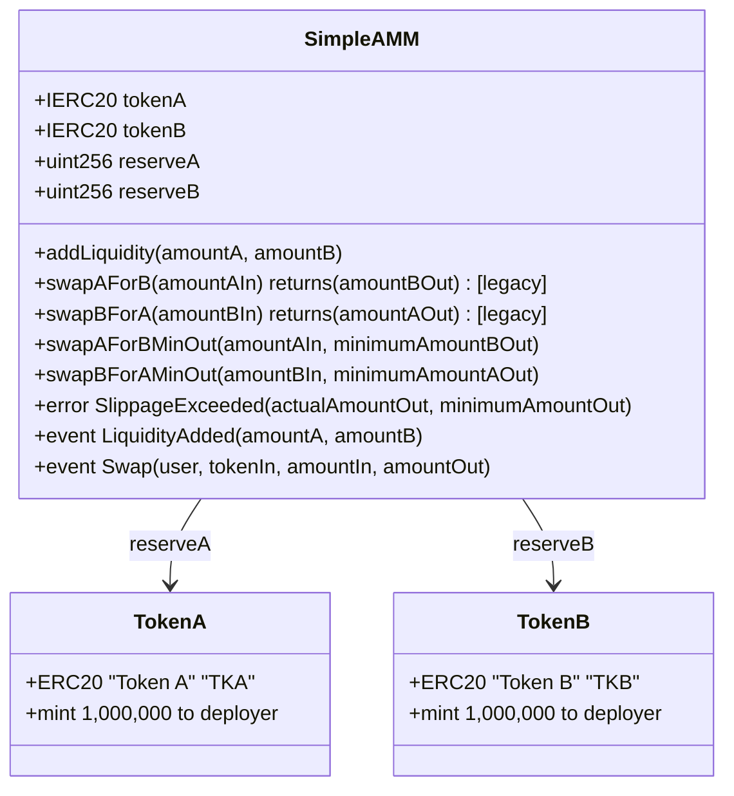
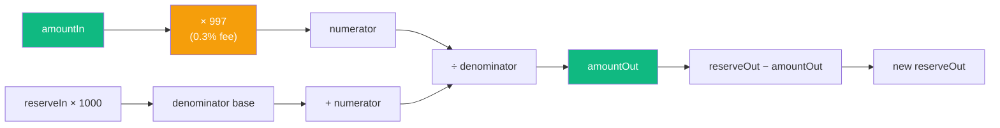
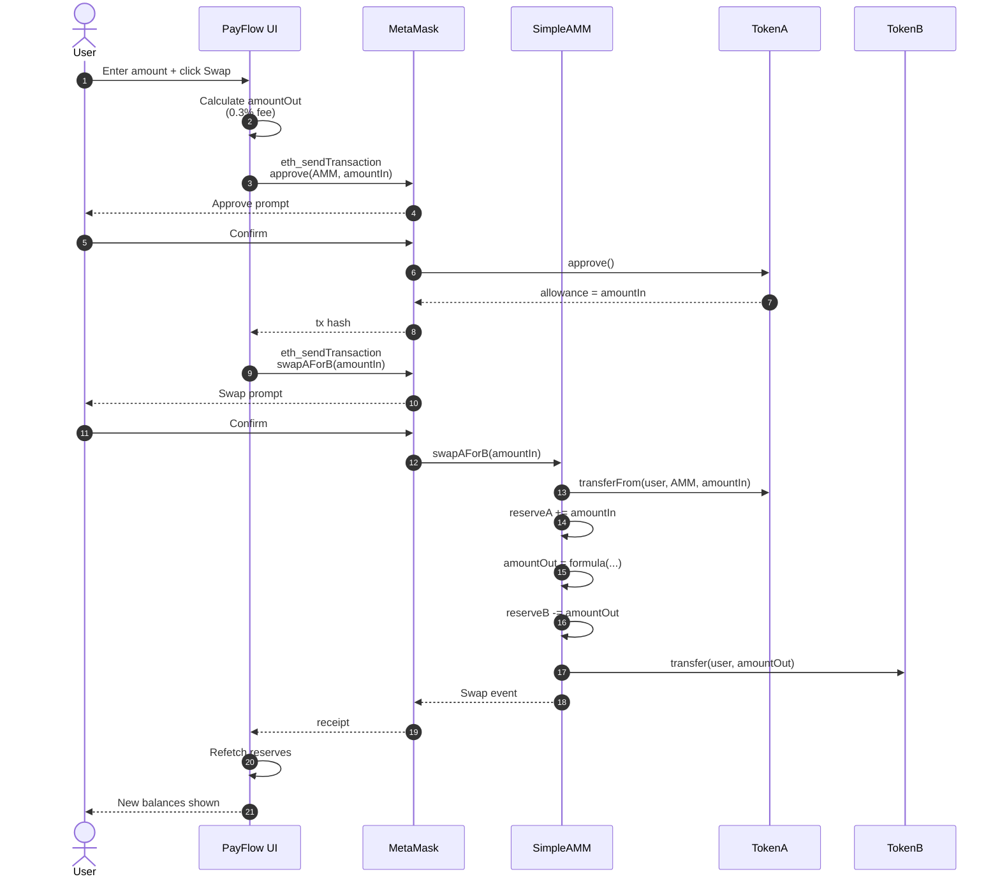
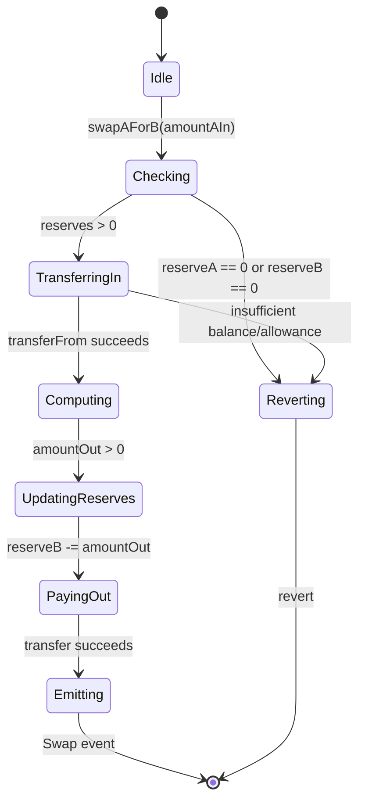
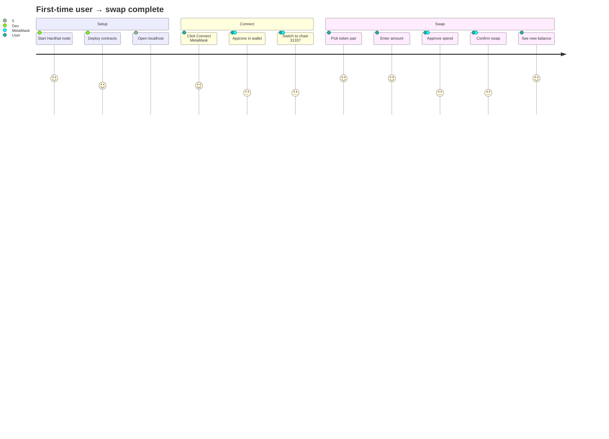
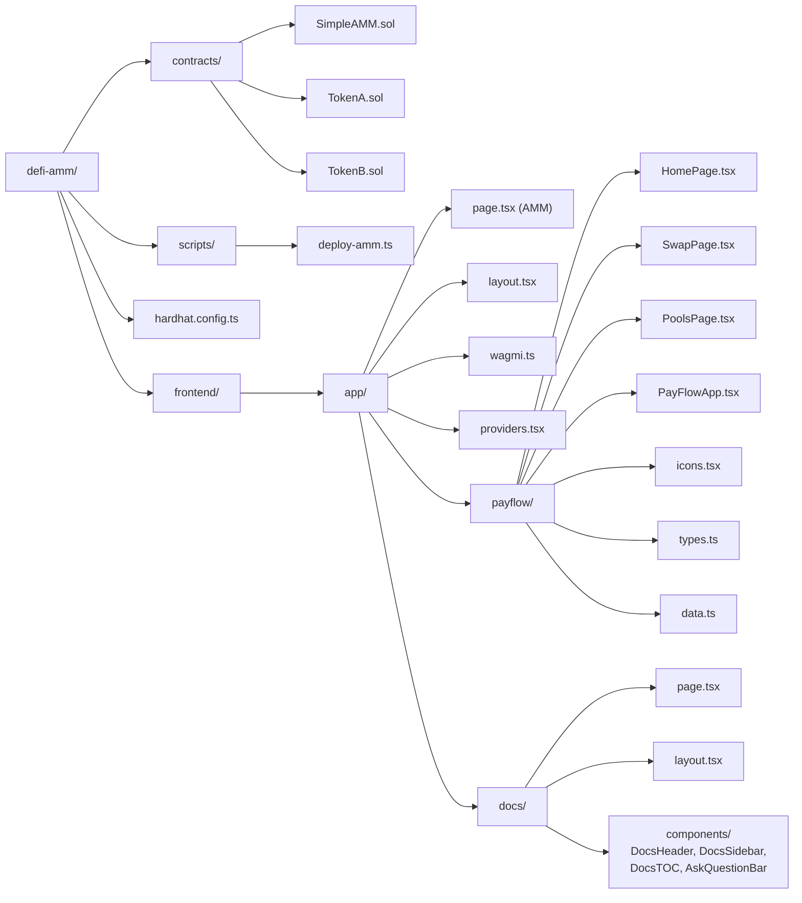
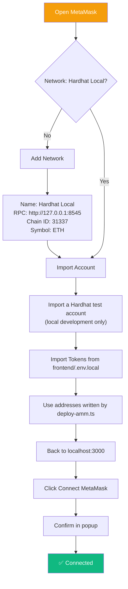

# PayFlow — DeFi AMM


A full-stack **hybrid wallet + DeFi AMM** demo running on a local Hardhat chain. Single-pool constant-product AMM with 0.3% swap fee, a PayFlow-style mobile UI, and an in-app docs page.

---

## 📑 Table of Contents

- [Features](#-features)
- [Architecture](#-architecture)
- [Contract Design](#-contract-design)
- [Swap Flow](#-swap-flow)
- [User Journey](#-user-journey)
- [Tech Stack](#-tech-stack)
- [Directory Structure](#-directory-structure)
- [Quick Start](#-quick-start)
- [MetaMask Setup](#-metamask-setup)
- [Environment Variables](#-environment-variables)
- [Routes](#-routes)
- [Troubleshooting](#-troubleshooting)
- [License](#-license)

---

## ✨ Features

- **Constant-product AMM** (`x * y = k`) with 0.3% fee
- **Single-pool** TKA ↔ TKB swap
- **Two-token liquidity** with reserve tracking on-chain
- **Injected wallet** connection (MetaMask, no WalletConnect required for local dev)
- **SSR-safe** Web3 state (cookie-based hydration, no flicker)
- **PayFlow UI** — mobile-first wallet dashboard (balance, quick actions, swap, earn)
- **Docs site** at `/docs` with auto-generated table of contents
- **Dark theme** across the whole app

---

## 🏗️ Architecture



Contract addresses are generated by the deployment script and saved to the ignored `frontend/.env.local`; they are not assumed or committed.

---

## 📜 Contract Design

### SimpleAMM

Single-pool AMM storing two reserves. No factory, no router — the pair **is** the entry point.



### Fee Formula



**Formula**: `amountOut = (amountIn × 997 × reserveOut) / (reserveIn × 1000 + amountIn × 997)`

---

## 🔄 Swap Flow

### Sequence: User swaps TKA → TKB



### State Machine: Contract-level swap



---

## 🚀 User Journey



---

## 🧰 Tech Stack

| Layer | Technology | Purpose |
|---|---|---|
| **Contracts** | Solidity 0.8.24 | AMM + ERC20 tokens |
| **Dev chain** | Hardhat 3 (EDR) | Local JSON-RPC at `:8545` |
| **Testing** | Mocha + Ethers.js (via Hardhat) | Contract test suite |
| **Frontend** | Next.js 16 (App Router, Turbopack) | SSR + client routing |
| **UI runtime** | React 19 | Server + client components |
| **Language** | TypeScript 7 | Full type safety |
| **Styling** | Tailwind 4 (CSS-first `@theme`) | Utility CSS + tokens |
| **Components** | shadcn/ui + ai-elements | Accessible primitives |
| **Web3** | wagmi v2 + viem | Hooks + typed contract calls |
| **Wallet** | Injected (MetaMask) | No WalletConnect needed |
| **State** | TanStack Query v5 | Cache + refetch |

---

## 📁 Directory Structure



---

## ⚡ Quick Start

### Prerequisites

- Node.js ≥ 22 LTS
- WSL2 (Ubuntu) or native Linux/macOS
- MetaMask browser extension

### 1. Install dependencies

```bash
# Repository root: Hardhat contracts and tests
npm install

# Frontend package with its npm lockfile
npm ci --legacy-peer-deps --prefix frontend
```

### 2. Start and deploy the local chain

```bash
# Terminal 1 — repository root
npx hardhat node

# Terminal 2 — repository root; deploys tokens + AMM, seeds liquidity,
# and updates only the three NEXT_PUBLIC_* addresses in frontend/.env.local
npx hardhat run scripts/deploy-amm.ts --network localhost
```

The deploy script preserves unrelated values already in `frontend/.env.local`. Restart the frontend dev server after deploying so Next.js reloads the new addresses.

### 3. Start the frontend

```bash
cd frontend
npm run dev
```

Open <http://localhost:3000/> for the landing page, <http://localhost:3000/payflow> for PayFlow, or <http://localhost:3000/wallet> for the wallet shell. See `/docs` for project documentation.

---

## 🦊 MetaMask Setup



| Field | Value |
|---|---|
| Network Name | Hardhat Local |
| RPC URL | `http://127.0.0.1:8545` |
| Chain ID | `31337` |
| Currency | ETH |

**Test account** (from `hardhat node` output):

```
Address:     0xf39fd6e51aad88f6f4ce6ab8827279cfffb92266
Private key: 0xac0974bec39a17e36ba4a6b4d238ff944bacb478cbed5efcae784d7bf4f2ff80
```

> ⚠️ **Never use these on a real chain** — they are publicly known.

---

## 🔐 Environment Variables

`frontend/.env.local`:

| Variable | Description | Example |
|---|---|---|
| `NEXT_PUBLIC_AMM_ADDRESS` | Deployed local `SimpleAMM` address | Written by `scripts/deploy-amm.ts` |
| `NEXT_PUBLIC_TOKEN_A_ADDRESS` | Deployed local `TokenA` address | Written by `scripts/deploy-amm.ts` |
| `NEXT_PUBLIC_TOKEN_B_ADDRESS` | Deployed local `TokenB` address | Written by `scripts/deploy-amm.ts` |

> `.env.local` is git-ignored. Use `.env.example` as the template.

---

## 🛣️ Routes

| Route | Description |
|---|---|
| `/` | AMM landing page |
| `/payflow` | PayFlow shell with balance home, swap, and pools screens |
| `/wallet` | Wallet dashboard with on-chain balances and pool reserves |
| `/wallet/swap` | Wallet-framed shared swap card |
| `/wallet/pools` | Wallet-framed pool reserves |
| `/docs` | Documentation site |

PayFlow switches between `home`, `swap`, and `pools` in shell state without changing the URL; wallet routes use App Router navigation.

---

## 🩺 Troubleshooting

<details>
<summary><b>ERESOLVE peer dependency error on <code>npm install</code></b></summary>

Add to `frontend/package.json`:

```json
"overrides": {
  "@solana/kit": { "typescript": "$typescript" }
}
```

Then `rm -rf node_modules package-lock.json && npm install`.
</details>

<details>
<summary><b><code>403 Forbidden</code> from Reown</b></summary>

You're using the placeholder `projectId`. Either:
- Get a real one at [dashboard.reown.com](https://dashboard.reown.com), or
- We already removed RainbowKit's `getDefaultConfig` — the app uses injected wallets only, so this warning is harmless.
</details>

<details>
<summary><b>Tailwind classes not applying (<code>bg-brand-*</code> shows nothing)</b></summary>

All tokens live in `frontend/app/globals.css` under `@theme`. If you deleted them, re-add:

```css
@theme inline {
  --color-brand-blue: #0070BA;
  /* ... */
}
```
</details>

<details>
<summary><b>MetaMask shows 0 balance</b></summary>

- Chain must be `31337`
- Import the **deployer** account (`0xf39f…`)
- Tokens don't appear automatically — import `TokenA` / `TokenB` addresses manually
</details>

<details>
<summary><b>Swap reverts with <code>execution reverted</code></b></summary>

- Confirm the `approve` tx mined before clicking Swap
- Ensure `balanceOf(user) ≥ amountIn`
- Check `reserveA > 0 && reserveB > 0` (add liquidity if empty)
</details>

---

## 🧪 Contract Tests

```bash
npx hardhat test
```

Covers:
- AMM swap output using the 0.3% fee formula
- Minimum-output success and slippage reversion
- Reserve updates and rollback after a reverted swap
- The starter Counter contract tests

---

## Architecture relationship verification — November 2026

| Source | Target | Relationship | Evidence | Status |
|---|---|---|---|---|
| User | AMM Landing (`/`) | Opens | `frontend/app/page.tsx` | Verified |
| User | PayFlow Route (`/payflow`) | Opens | `frontend/app/payflow/page.tsx` | Verified |
| PayFlow Route | PayFlow Shell | Renders | `frontend/app/payflow/page.tsx` | Verified |
| PayFlow Shell | Balance Home | Renders | `frontend/app/payflow/PayFlowApp.tsx` | Verified |
| PayFlow Shell | Swap Screen | Renders | `frontend/app/payflow/PayFlowApp.tsx` | Verified |
| PayFlow Shell | Pool Screen | Renders | `frontend/app/payflow/PayFlowApp.tsx` | Verified |
| Swap Screen | Quote data | Reads quote from reserves and computes fee-adjusted output | `frontend/app/payflow/components/SwapPage.tsx`, `frontend/components/SwapCard.tsx` | Verified |
| Pool Screen | Pool data | Reads contract reserves | `frontend/app/payflow/components/PoolsPage.tsx`, `frontend/components/ReservesDisplay.tsx` | Verified |
| PayFlow Balance Home | Token balances | Displays live ERC-20 balances for the connected wallet | `frontend/app/payflow/components/HomePage.tsx`, `frontend/components/TokenBalances.tsx` | Verified |
| Wallet Shell | Wallet Dashboard | Frames | `frontend/app/wallet/layout.tsx`, `frontend/app/wallet/page.tsx` | Verified |
| Wallet Shell | Wallet Pools | Frames | `frontend/app/wallet/layout.tsx`, `frontend/app/wallet/pools/page.tsx` | Verified |
| Wallet Shell | Wallet Swap | Frames | `frontend/app/wallet/layout.tsx`, `frontend/app/wallet/swap/page.tsx` | Verified |
| Wallet Shell | Wallet Bar | Uses | `frontend/app/wallet/layout.tsx`, `frontend/components/WalletBar.tsx` | Verified |
| Wallet Swap | Swap Card | Uses | `frontend/app/wallet/swap/page.tsx`, `frontend/components/SwapCard.tsx` | Verified |
| Wallet Dashboard | Token balances | Displays live ERC-20 balances for the connected wallet | `frontend/app/wallet/page.tsx`, `frontend/components/TokenBalances.tsx` | Verified |
| Wallet Dashboard | Reserve Display | Uses live reserve panel | `frontend/app/wallet/page.tsx`, `frontend/components/ReservesDisplay.tsx` | Verified |
| AMM Landing | Web3 Providers | Uses app-level provider tree | `frontend/app/layout.tsx`, `frontend/app/providers.tsx` | Verified |
| Web3 Providers | Wallet Config | Configures wagmi | `frontend/app/providers.tsx`, `frontend/app/wagmi.ts` | Verified |
| Wallet Config | Injected Wallet | Configures injected connector | `frontend/app/wagmi.ts` | Verified |
| Injected Wallet | Local Hardhat Chain | Supplies contract reads and signs transactions after switching to chain 31337 | `frontend/app/wagmi.ts`, `frontend/components/WalletBar.tsx` | Configured; browser-wallet transaction untested |
| Local Hardhat Chain | Constant-Product AMM | Hosts the deployed local AMM | `hardhat.config.ts`, `scripts/deploy-amm.ts` | Verified in this workspace; ephemeral chain |
| Constant-Product AMM | Pool Tokens | Uses ERC-20 token contracts and reserves | `contracts/SimpleAMM.sol`, `contracts/TokenA.sol`, `contracts/TokenB.sol` | Verified |
| Swap Card | Contract ABI | Uses min-output swap and approval methods | `frontend/components/SwapCard.tsx`, `frontend/lib/abi.ts` | Verified |
| Reserve Display | Contract ABI | Reads `reserveA` and `reserveB` | `frontend/components/ReservesDisplay.tsx`, `frontend/lib/abi.ts` | Verified |
| Production deployment | Contract addresses | Requires environment-specific deployed addresses; none are committed or assumed | `frontend/lib/constants.ts`, `frontend/.env.example` | Missing until deployed/configured |

**Local setup:** the deployment script seeds the Hardhat pool and writes the generated addresses to the git-ignored `frontend/.env.local`, preserving unrelated existing values. The wallet control can add or switch to Hardhat Local (chain ID 31337). Contract reads use the injected wallet provider when available, with HTTP fallback. `NEXT_PUBLIC_HARDHAT_RPC_URL` defaults to `http://127.0.0.1:8545`; in a hosted preview, `127.0.0.1` refers to the viewer's own computer, so use a reachable RPC endpoint if the local node is not on that machine. This `NEXT_PUBLIC_` URL is exposed to browsers and must not contain a private API key. Production contracts, network access, and user wallet behavior remain environment-dependent and require separate verification.

---

## 📜 License

MIT © 2026 kk666679
